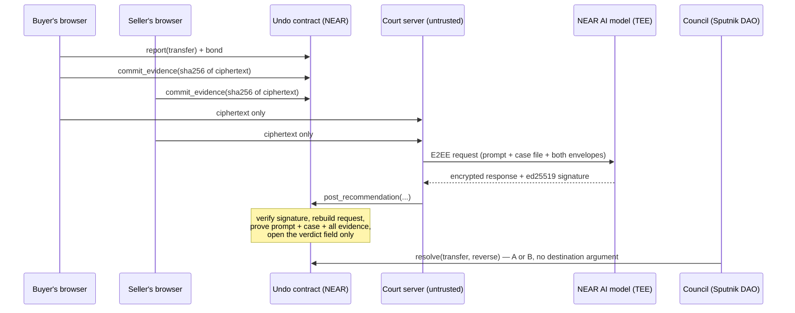

# Undo — reversible USDC on NEAR, with a private AI court whose procedure is verified on-chain

[](https://github.com/agadape/undo/actions/workflows/test.yml) Contract tests (60 unit + property) and a web app type check run on every push.

**Live app (NEAR testnet):** https://undo-cyan.vercel.app/?lang=en · **Every claim with its evidence:** [CLAIMS.md](CLAIMS.md) · Built at NEAR HACKATHON (1–14 Nov 2026)

Undo is a wrapped-USDC token (`rUSDC`, 1:1) where every outgoing transfer waits in an undo window before it becomes final. It undoes two kinds of loss:

- **Stolen key.** The owner's recovery account (for example, a phone) presses **panic**. That freezes the thief's pending transfers. If nobody contests, the money returns to the recovery account without any vote.
- **Fake seller.** The buyer reports the payment with a bond. Both sides send evidence that is encrypted in the browser to an attested NEAR AI model running in a TEE. The NEAR contract checks the model's signature, proves which prompt, case and evidence the model read, and opens only the verdict field. A council (Sputnik DAO) then picks one of two fixed destinations.

Everything runs on NEAR testnet. No real money is involved.

## The problem

A crypto transfer is final. With a leaked key or a fake online seller, the money is gone once it leaves. Card networks have chargebacks and banks can recall transfers, but those depend on an operator who sees all your evidence and can move money anywhere. Undo keeps the undo, removes the operator:

- **No owner.** The contracts have no admin functions and no access keys.
- **Two destinations only.** Pending money can end only at the receiver or the sender's recovery account.
- **Private evidence.** Dispute evidence stays encrypted even from us; only the AI's verdict is opened, and the contract checks how that verdict was produced.

## How it works

| Part | What happens | Main code |
|---|---|---|
| **rUSDC with an undo window** | Deposit USDC and get rUSDC 1:1. A transfer stays *pending* for the window (5 min on the public demo; the intended product setting is 24 h), then becomes final. Unwrapping and `send_usdc` (paying someone who does not use Undo, in plain USDC) wait for the window too. "Barang diterima" (goods received) releases a payment early, but only from the sender's recovery account | [`undo/contracts/undo-token/src/lib.rs`](undo/contracts/undo-token/src/lib.rs) |
| **Panic button** | The recovery account calls `panic`. The account locks, every pending outgoing transfer freezes, and the remaining balance becomes a frozen sweep toward the recovery account. After the contest window (2 min on the demo) anyone can `finalize`. A function-call key limited to `panic` is enough, so a guard bot can hold it without being able to move money | `panic`, `finalize`, `unlock` in `lib.rs` |
| **Trusted contacts** (v2) | A payment to an active contact (a regular shop, family) is final at once, with no window. A new contact becomes active only after a delay (5 min on the demo, never shorter than the window), an alert shows up, and `panic` cancels contacts that are not active yet; the recovery account can remove any contact without a panic. So a thief who adds himself has to wait like any pending transfer | `add_contact`, `remove_contact`, `cancel_contact` in `lib.rs` |
| **Private court** | The sender reports (bond 0.01 NEAR). Each side encrypts evidence in the browser to the attested model key that is pinned on-chain, and commits its sha256. Our server calls NEAR AI with end-to-end encryption and posts the signed result to `post_recommendation`. The contract does four things. (1) It verifies the TEE ed25519 signature over the encrypted request and response. (2) It rebuilds the exact request bytes from the registered prompt hash, this case's on-chain file and every committed evidence envelope. (3) It opens the system message with a key it derives itself (X25519 + HKDF). (4) It decrypts only the verdict field; the model's reasoning stays encrypted. The recommendation is stored and **moves no money**; the council decides | `post_recommendation` in `lib.rs`, [`undo/app/lib/court.ts`](undo/app/lib/court.ts), [`undo/app/app/api/court/run/route.ts`](undo/app/app/api/court/run/route.ts) |



### Promises enforced by the code

| # | Promise |
|---|---|
| J1 | Pending money ends only at the receiver or the sender's recovery account. No function, including the council's, takes a destination |
| J2 | Only money still inside its window can be touched |
| J3 | The AI never moves money. If the council stays silent, the challenged state stands |
| J4 | Only the sender or its recovery account can report, with a bond; losses are counted on-chain |
| J5 | No owner; the deployed contracts have 0 access keys |
| J6 | rUSDC supply always equals the USDC the contract holds |
| J7 | The court server cannot change what the model reads: prompt, case file and the complete evidence are proven on-chain |
| T0 | A new trusted contact waits at least as long as the window; panic cancels it; a payment to an active contact is final (J2 holds: it has no window) |

[CLAIMS.md](CLAIMS.md) maps each promise to code lines, tests and testnet transactions.

## Try it (no wallet needed, about 5 minutes)

The interface is in English. The court's prompt is in English too; the AI writes its public reason in two languages ("ID: … EN: …") and the page shows the English part. Demo accounts and their keys live in your browser only.

**A. A stolen key, undone without a vote**

1. Open https://undo-cyan.vercel.app/dompet?lang=en and click **Set up demo wallet**.
   You should see two new testnet accounts: the main wallet and its recovery account. **Available** shows 100.00 rUSDC.
2. In the card **Test the panic button**, step 1, click **Simulate theft**.
   You should see 90 rUSDC sent to a "Thief" account. The transfer is pending, so the thief cannot use it. A red alert appears at the top of the page: "Money is leaving Main wallet. Was this you?".
3. Click **No — PANIC** in the alert (or step 2, **PANIC**). This step is signed by the recovery account; the message ends with "gasless: paid by the Undo relayer".
   You should see the theft frozen, the wallet locked, and the remaining 10 rUSDC frozen toward the recovery account.
4. Wait 120 seconds, then in step 3 click **Finalize**.
   You should see the recovery account holding all 100 rUSDC. Nobody voted.
5. Step 4, **Unlock**. Optionally, step 5 **Send back**.

**B. A fake seller, judged by a private AI court** (about 10 minutes, one NEAR AI call)

6. In **Other demo accounts**, click **+ Create "Seller / shop" account**.
7. In **Send**, put the seller's account in **Receiver**, enter 30, keep "rUSDC (receiver uses Undo)", then click **Send**.
8. Under **History → Outgoing**, click **Report fraud** on that payment (this attaches the 0.01 NEAR bond). The court page `/sidang/<id>` opens.
9. On the court page, write the buyer's evidence and click **Encrypt in browser & send**.
   You should see the evidence hash committed on-chain. Only ciphertext reaches our server.
   To answer as the seller, switch the active account in the header to the seller and do the same.
10. When both sides have answered, or after the 5-minute evidence window, click **Run the court (1 NEAR AI call)**.
    You should see the recommendation (`kembalikan` = return to the sender, `lanjutkan` = pay the receiver), its confidence, `curiga_injeksi` (suspected injection) and a public reason. You also see the `post_recommendation` transaction. The money has not moved.
11. The council decides on `/dewan`. It is a DAO of three team members and a decision needs 2 of 3 votes: one member proposes and votes from the page (passcode held by the team), another approves with their own wallet on the same card.
    If the council stays silent for 30 minutes, anyone can press **Apply council silence** on the court page. For a fraud report, the money then goes to the receiver: the AI alone never moves money (J3).

**C. Trusted contacts** (about 6 minutes)

12. In **Trusted contacts**, add the seller's account and click **Add contact**.
    You should see "active in 4m 59s". No red alert appears for it, because you added it here; a contact added from anywhere else shows up in the alert.
13. After 5 minutes, send 10 rUSDC to the seller.
    You should see "⚡ Trusted contact" above the button, then "Sent to a trusted contact — final at once", and in **History** "final at once (contact)". Switch to the seller: the 10 rUSDC is available immediately.
14. Switch to the recovery account and click **Remove contact** next to the seller (gasless). A new payment to the seller is pending again.

**D. Check the promises and the challenge**

15. https://undo-cyan.vercel.app/janji?lang=en runs the J1–J7 checks live against the chain:
    - 0 access keys on the contract;
    - code hash = the reproducible v2 build;
    - reserve 1:1;
    - pinned model key;
    - the prompt hash recomputed in your browser matches the on-chain hash.
16. https://undo-cyan.vercel.app/coba-curi?lang=en ("try to steal") is a locked instance whose bait account key is meant to be published. A guard presses panic on every outgoing transfer. The page shows attempts, frozen transfers, money cashed out (0 so far) and reaction time.

You can also click **Connect wallet** to use a real NEAR testnet wallet through NEAR Connect instead of the demo keys.

## Tracks

### `privacy` — Private AI, TEE, NEAR AI Cloud

| Feature | Files | Try |
|---|---|---|
| Evidence encrypted in the browser to the attested NEAR AI model key (NEAR AI E2EE v2: X25519 + HKDF-SHA256 + XChaCha20-Poly1305) | [`undo/app/lib/court.ts`](undo/app/lib/court.ts), [`undo/app/app/sidang/[id]/page.tsx`](undo/app/app/sidang/%5Bid%5D/page.tsx) | Steps 9–10 |
| TEE signature verified on-chain over the **encrypted** bytes; only the verdict field opened, reasoning stays encrypted | `post_recommendation` in [`lib.rs`](undo/contracts/undo-token/src/lib.rs) | The `post_recommendation` tx from step 10 |
| Procedure proof: the contract rebuilds the request and proves the model read the registered prompt, this case and every committed evidence item | same | [CLAIMS.md §3](CLAIMS.md#3-private-court-with-an-on-chain-procedure-proof-j7) |
| Attestation (Intel TDX + NVIDIA) checked before every run; key pinned on-chain by the council | [`undo/app/app/api/court/run/route.ts`](undo/app/app/api/court/run/route.ts) | `/janji` shows the pinned key |

### `realworld` — Stablecoin rails

| Feature | Files | Try |
|---|---|---|
| Wrapped USDC 1:1 with a public reserve check (`get_reserve`) | `lib.rs` | `/janji` |
| `send_usdc`: pay anyone in plain USDC after the window; the receiver does not need Undo | `send_usdc`, `withdraw` in `lib.rs` | **Send** with "plain USDC (any receiver)" selected |
| "Goods received": a buyer releases payment early from the recovery account | `release` in `lib.rs` | **Goods received** on an outgoing payment |
| Business use: a treasury or payroll account where a payment to a fake invoice can still be undone | — | Scenario B |
| Trusted contacts: a regular shop is paid with no window (final at once), while a contact a thief adds has to wait and can be cancelled | `add_contact`, `transfer` in `lib.rs`, contacts card in [`undo/app/app/dompet/page.tsx`](undo/app/app/dompet/page.tsx) | Scenario C |
| Gasless safety actions (NEP-366 meta-transactions): the recovery account on your phone needs no NEAR for gas. Panic, finalize, unlock, goods received, cancelling a recovery change and applying council silence go through our relayer, which checks the signature, the access key, the nonce, the expiry and that the contract will accept the call before it pays. If the relayer is down, the app signs a normal transaction instead | [`undo/app/lib/server/relay.ts`](undo/app/lib/server/relay.ts), [`undo/app/lib/near-client.ts`](undo/app/lib/near-client.ts) | Scenario A: the panic card shows the recovery account's NEAR, unchanged after steps 2–4 |

Not used: NEAR Intents (no testnet deployment). See [CLAIMS.md §8](CLAIMS.md#8-not-built-).

### `security` — Function-call keys, TEE attestation

| Feature | Files | Try |
|---|---|---|
| Panic with a function-call key limited to `panic`, `finalize`, `unlock` and `release_expired`: the guard can freeze a theft but cannot move money | [`undo/app/guard/guard.mjs`](undo/app/guard/guard.mjs) | `/coba-curi` |
| Delayed, cancellable recovery-account changes; a stolen recovery account cannot take the balance (frozen sweep, contestable by the owner) | `set_recovery`, `contest` in `lib.rs` | [CLAIMS.md §2](CLAIMS.md#2-panic-button-theft-undone-without-any-vote) |
| Locked contracts (0 keys) with a code hash that matches the published wasm | [`undo/contracts/wasm/`](undo/contracts/wasm/) | [CLAIMS.md §6](CLAIMS.md#6-check-it-yourself-no-keys-needed) |
| Threat model A1–A9 (stolen main key, waiting out the window, recovery swap, stolen recovery account, …) as unit tests | [`undo/contracts/undo-token/src/tests.rs`](undo/contracts/undo-token/src/tests.rs) | `cargo test -p undo_token` |

## How NEAR fits in

- **Cheap on-chain crypto.** `env::ed25519_verify` and `env::sha256` are host functions. Verifying a TEE signature, rebuilding a 2.4 KB request, two X25519 operations and two decryptions cost about **10.7 Tgas (≈ 0.001 NEAR)** per verdict.
- **NEAR AI Cloud.** It provides attested TEE models with end-to-end encrypted requests and per-field response keys. That makes "verdict open, reasoning sealed" possible. One court run costs about $0.0002–0.0005.
- **Meta-transactions (NEP-366).** The recovery account signs a delegate action and our relayer pays the gas, so a phone account needs no NEAR to press panic. The contract still sees the recovery account as the caller.
- **Accounts and keys.** Function-call keys power the panic-only guard. The challenge's bait account is a sub-account of the guard, so nobody else can recreate it.
- **Sputnik DAO.** The council is a DAO. Every decision is a public proposal and vote, and its power is limited by J1–J3.
- **NEAR Connect** for wallet sign-in. The app also works with in-browser demo keys.

## Prior art and what is new

| Project | What it does | Difference |
|---|---|---|
| [ERC-20R / 721R](https://arxiv.org/abs/2208.00543) (Wang, Wang, Boneh, 2022) | Reversible tokens; a decentralized judge panel can reverse within a window | Undo resolves undisputed theft through the recovery account without judges; disputes are read by a private AI whose procedure is checked on-chain |
| [REVERSO](https://github.com/Faraone-Dev/REVERSO) | Opt-in timelocked transfers the sender can cancel (EVM) | Opt-in per transfer, so a thief simply uses a normal transfer; in Undo every outgoing transfer waits. No court |
| [SLOW](https://www.bankless.com/read/a-safety-layer-for-high-stakes-crypto-sends) | Held transfers with an optional guardian approving each outflow | A guardian approves every send; Undo's recovery account acts only on panic. No fraud court |
| [Circle Refund Protocol](https://www.circle.com/blog/refund-protocol-non-custodial-dispute-resolution-for-stablecoin-payments) | Non-custodial escrow; the arbiter can only refund the payer or pay the receiver | **J1 follows the same idea.** Their arbiter sees evidence in the clear |
| [Payy Finality](https://gizmodo.com/cryptos-latest-stablecoin-innovation-chargebacks-2000811401) | Short objection window; LPs guarantee payment; neutral arbiters judge evidence | Arbiters see evidence; Undo's evidence stays encrypted |
| [Veridom Pay](https://github.com/khrisdidukh/veridom-pay), [tee-receipts](https://github.com/tmdry4530/tee-receipts) (projects at this hackathon) | Verify NEAR AI signatures in a NEAR contract | Same signature check as ours. Their request files are public; ours are encrypted to the enclave, and only the verdict field is opened |

What we believe is new: dispute evidence that stays encrypted even from the operator; a TEE signature checked on-chain over that ciphertext; a verdict-only opening; and an on-chain proof of the court procedure (prompt, case file, complete evidence) without opening the evidence.

## Deployed on testnet

| What | Account |
|---|---|
| Public demo contract v2 (locked, used by the app; trusted contacts) | [`undo-demo-v2.testnet`](https://testnet.nearblocks.io/address/undo-demo-v2.testnet) |
| Public demo contract v1 (locked, still live; the court and council evidence of 3 Nov) | [`demo.nh-s26r-mvz1zxfx.testnet`](https://testnet.nearblocks.io/address/demo.nh-s26r-mvz1zxfx.testnet) |
| Coba Curi challenge (locked) | [`cobacuri.nh-s26f-mvz1xz1q.testnet`](https://testnet.nearblocks.io/address/cobacuri.nh-s26f-mvz1xz1q.testnet), bait `curi.nh-s26f-mvz1xz1q.testnet` |
| Council (Sputnik DAO) | [`nhspike-mvp6a0dx.sputnikv2.testnet`](https://testnet.nearblocks.io/address/nhspike-mvp6a0dx.sputnikv2.testnet) |
| Underlying token | `usdc.fakes.testnet` (testnet USDC, open mint) |
| Court model | `z-ai/glm-5.3-flash` on NEAR AI Cloud (TEE), ed25519 key `5a0210f2…` pinned on-chain |
| Wasm code hash, v2 | `AzDhXsj2JzWQAEjScj5SrubF4Q96VCLPHTRawcpHnZkJ`: a reproducible build (`cargo near build reproducible-wasm` at commit `65c1c0e`), [`undo_token_v2.wasm`](undo/contracts/wasm/undo_token_v2.wasm) |
| Wasm code hash, v1 (v1 demo, Coba Curi, S25 copy) | `5q9rRircqxg9Bko6gHa4k1ejQzvrb9zgQkkXaZSPsrGz` (git tag `contract-v1`) |

## Repository map

| Path | Contents |
|---|---|
| [`undo/contracts/undo-token`](undo/contracts/undo-token) | Product contract v2 (Rust, near-sdk 5.30): `lib.rs`, 60 unit tests in `tests.rs`, property test in `fuzz_tests.rs`; v1 is git tag `contract-v1` |
| [`undo/contracts/wasm`](undo/contracts/wasm) | Built wasm + ABI of the deployed contracts |
| [`undo/contracts/s22-verifier`](undo/contracts/s22-verifier), [`s26-court`](undo/contracts/s26-court) | Spike contracts for the signature check and the procedure proof |
| [`undo/app`](undo/app) | Next.js 16 web app, court server (`app/api`), guard (`guard/`) |
| [`spikes/`](spikes) | Feasibility scripts S0–S26 and recorded outputs (`spikes/out/`); results in [SPIKE_LOG.md](SPIKE_LOG.md) |
| [CLAIMS.md](CLAIMS.md) | Claim → code → test → transaction |
| [PLAN_UNDO.md](PLAN_UNDO.md), [DEPLOY.md](DEPLOY.md) | Team plan and deployment notes (in Indonesian) |

## Build and test

Contract (Rust + [`cargo-near`](https://github.com/near/cargo-near); we build in WSL Ubuntu):
```bash
cd undo/contracts
cargo test -p undo_token                                         # 60 unit tests + property test (4 seeds)
UNDO_FUZZ_SEEDS=40 cargo test --release -p undo_token property   # 16,000 random steps, ~4 min
bash build.sh                                                    # wasm into undo/contracts/wasm
```

Reproducible build of the deployed v2 (needs Docker; inside a clean clone at commit `65c1c0e`):
```bash
cd undo/contracts/undo-token
cargo near build reproducible-wasm   # sha256 bs58 must be AzDhXsj2JzWQAEjScj5SrubF4Q96VCLPHTRawcpHnZkJ
```

Web app (Node 24):
```bash
cd undo/app
npm install
npm run dev   # http://localhost:3100
```

The app's server routes read secrets from the repository root `.env`; [`.env.example`](.env.example) lists them. You need a NEAR AI API key for the court and a funded testnet account for demo accounts and council actions. Pages that only read the chain work without them.

## Limits

These are listed in full in [CLAIMS.md §7–8](CLAIMS.md#7-trust-boundaries-what-you-still-have-to-trust):

- The model's TEE attestation is verified off-chain; the contract checks signatures against the key the council pinned.
- The council is a Sputnik DAO with three members, all from our team (`nh-spike-mvp62mw4`, `smoothicon6710`, `biguser4780`); a decision needs 2 of 3 votes. An independent council is future work.
- The Coba Curi guard runs as a Cloudflare Worker every minute (heartbeat: https://undo-cobacuri-guard.agadape.workers.dev), with GitHub Actions as a slower backup. The bait key is not published yet.
- Evidence is text only.
- Testnet only.
- A payment to a trusted contact cannot be undone: a stolen key can pay the owner's ACTIVE contacts at once. Keep few contacts; the recovery account can remove one at any time.
- Not built yet: appeal keys, notifications outside the browser (the alert shows only where the recovery account's key is), mainnet. v1 instances (the v1 demo, Coba Curi) were built before the reproducible setup; only v2 is a reproducible build.

## Credits

Design help: Dex Bennett (visual direction and front-end design, not a team member)

**Sister project** by the same team, disclosed per hackathon rule Q-015: [Laurel](https://github.com/agadape/laurel), small
decision models as on-chain infrastructure on NEAR. Models compete on a private test set scored inside a TEE (OutLayer), and
the winner becomes a contract method that AI agents and other contracts pay per prediction (live at
https://laurel-near.vercel.app). The two projects are independent products with separate contracts, sites and repositories;
they share only the team and some early research notes. Laurel's README carries the same disclosure pointing here.
